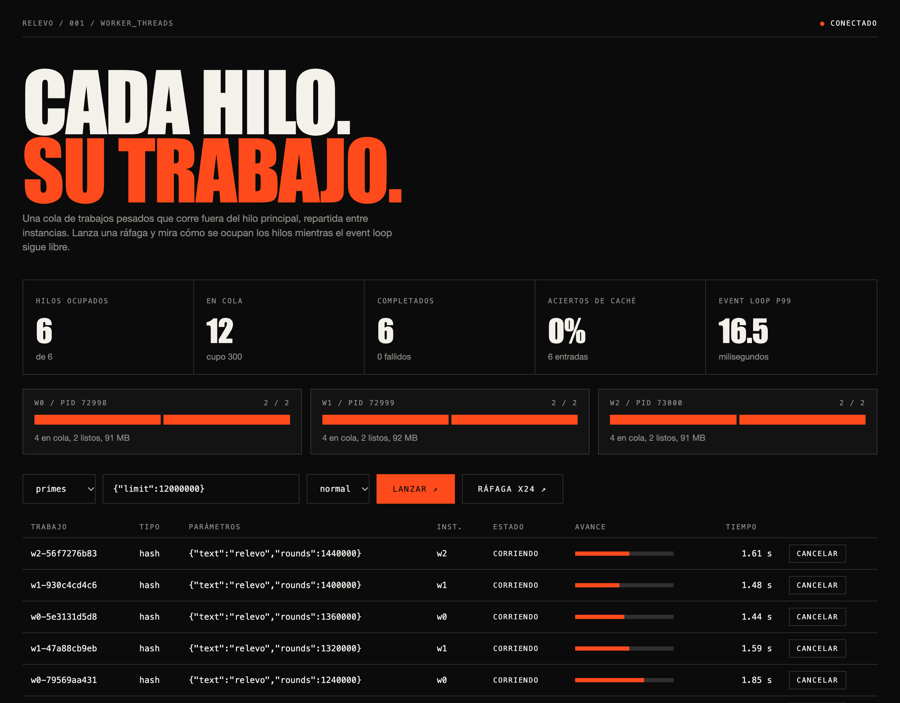

# relevo

A CPU-bound job service for Node.js. Heavy work runs in a `worker_threads` pool, never on the event loop. Jobs are submitted over REST, GraphQL or WebSocket, and several instances sit behind a small load balancer written for this project.



Only two runtime dependencies: `graphql` and `ws`. Everything else is Node's standard library.

## Run it

```bash
npm install
npm start          # one instance on http://127.0.0.1:3000
npm run cluster    # balancer on :3000, instances on :3100+ (INSTANCES=3 PORT=3000)
npm test           # 36 tests, node:test
npm run bench      # main thread vs pool
npm run profile    # --cpu-prof of the main-thread run
```

Open `/` for the live dashboard (Spanish UI).

## API

```bash
# REST
curl -X POST localhost:3000/jobs -H 'content-type: application/json' \
  -d '{"type":"fib","params":{"n":38},"priority":"high"}'
curl localhost:3000/jobs/<id>          # GET reads, DELETE cancels
curl localhost:3000/metrics

# GraphQL
curl localhost:3000/graphql -H 'content-type: application/json' \
  -d '{"query":"mutation { enqueue(type: primes, params: {limit: 20000000}) { id status } }"}'

# WebSocket: ws://localhost:3000/ws
# server pushes {"type":"job","job":{...}} on every state change
# client sends {"op":"enqueue","type":"fib","params":{"n":30}} or {"op":"cancel","id":"..."}
```

Job types: `fib`, `primes`, `hash`, `wordfreq`, `sleep`. Input is validated before it reaches a worker; errors map to 400, 404 or 429.

## How it works

- **Pool** (`src/pool.js`): fixed worker threads, three priority queues, bounded queue (`QueueFullError`, answered as 429), per-job timeout, cancellation. Synchronous code cannot be interrupted, so a timeout or cancel terminates that worker and a fresh one takes its slot.
- **Single flight and cache** (`src/service.js`, `src/cache.js`): identical jobs in flight share one pool task; finished results go to an LRU cache with TTL. Cancelling one of several waiters keeps the task alive; cancelling the last one kills it.
- **Balancer** (`src/balancer.js`): least-connections with round-robin tie break, health checks, failover. Job ids carry their instance (`w1-ab12...`), so `GET /jobs/:id` and GraphQL queries that mention an id go to the instance that owns it. `/jobs` and `/metrics` fan out and merge; `/ws` fans in every instance's live feed.
- **Cluster** (`src/cluster.js`): the primary forks instances, restarts crashed ones with growing delay, and splits `cores - 1` threads between them so instances times threads never exceeds the cores.
- **Metrics** (`src/metrics.js`): pool counters, cache hit rate and event loop delay (`monitorEventLoopDelay`) per instance.

## Numbers

`npm run bench` on an M1 (4 performance + 4 efficiency cores), 16 jobs of `fib(39)`:

| mode | total | speedup | longest event loop block |
| --- | --- | --- | --- |
| main thread | 10846 ms | 1.0x | 745 ms |
| worker pool (2 threads) | 5697 ms | 1.9x | 7 ms |
| worker pool (4 threads) | 4014 ms | 2.7x | 50 ms |
| worker pool (7 threads) | 2875 ms | 3.8x | 10 ms |

On the main thread the event loop stalls for most of a job while it runs. With the pool it stays under a few tens of milliseconds. Speedup is below linear because the last three cores are slower efficiency cores, and runs vary by a few hundred milliseconds. Hash-heavy jobs scale worse than `fib` since every round allocates, so the garbage collector competes.

200 identical requests ran once, in about 0.7 s; 200 more were answered from the cache in about 5 ms.

`npm run profile` confirms where the main-thread time goes: 99.5% self time in `fibNaive`, so the pool is the right fix, not micro-optimizing the handler.

## Limits

- State is in memory. Restarting an instance loses its jobs; the balancer reports `INSTANCE_DOWN` (503) for ids owned by a dead instance.
- No authentication. Put it behind your own gateway.
- The balancer is a learning-grade proxy: it buffers request bodies (1 MB cap) and does not do TLS.

MIT license.
